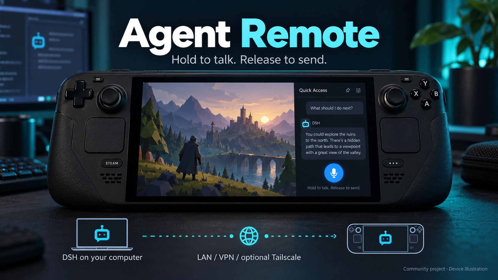

# Agent Remote for Decky

Talk to **remote DSH agents** without leaving Steam Deck Gaming Mode. Open one panel to read replies, hold a rear button to speak, release to send. Execution and speech recognition run on your computer.

[中文说明](README.zh-CN.md) · [Install & configure](docs/SETUP.md) · [Security](SECURITY.md) · [Contribute](CONTRIBUTING.md) · [Releases](https://github.com/kongdayan/decky-agent-remote/releases)



## The interaction

**Open → latest reply. Hold → talk. Release → send.** Chat history and the microphone stay on the same page. The panel remembers the selected machine and session; background notifications lead back to the full conversation. No terminal runs on Deck.

- DSH session list, full replies, paginated history and new sessions.
- Multiple execution machines, configured directly in the plugin.
- R4 / L4 / R5 / L5 push-to-talk, X / touch controls, optional review before sending.
- Local whisper.cpp Mandarin ASR with simplified Chinese output.
- Optional Codex app-server adapter. DSH is always enabled.
- LAN, HTTPS, SSH tunnels or a VPN. **Tailscale is optional.**

## Get started

1. Run the bridge on your DSH machine: Node 24 LTS, DSH Web, and optional ffmpeg + whisper.cpp for voice.
2. Install the release ZIP through Decky's developer install option.
3. Add the machine URL and generated token in Agent Remote. Choose a DSH session and talk.

Follow the [complete setup guide](docs/SETUP.md) for actual commands, network choices and troubleshooting. Credentials and models are configured locally and are never bundled. Use an encrypted/private transport; the bridge has remote agent access. Read [the security boundary](SECURITY.md).

## Status and limits

Public preview, version 0.4.0. Built from the official Decky plugin template under BSD-3-Clause. GitHub sideload distribution; no Decky Store approval is claimed. DSH adapter tested against 0.2.0-rc.2; its prerelease RPC can change. Codex desktop chats owned by another app-server may be read-only. Approval prompts must be handled on the execution machine. The UI is currently Chinese; English documentation is provided.

See [validation](docs/VALIDATION.md) for measured checks and untested cases, and [UX audit](docs/UX-AUDIT.md) for interaction decisions. Public screenshots use synthetic demo conversations; device-frame artwork is a labeled illustration.

## Development

```sh
pnpm install --frozen-lockfile
pnpm typecheck
pnpm test
pnpm build
python3 scripts/check_public.py
python3 scripts/package.py
```

[Changelog](CHANGELOG.md). Steam Deck, Decky, DSH, DeepSeek and Codex belong to their respective owners. This is an independent community project.
