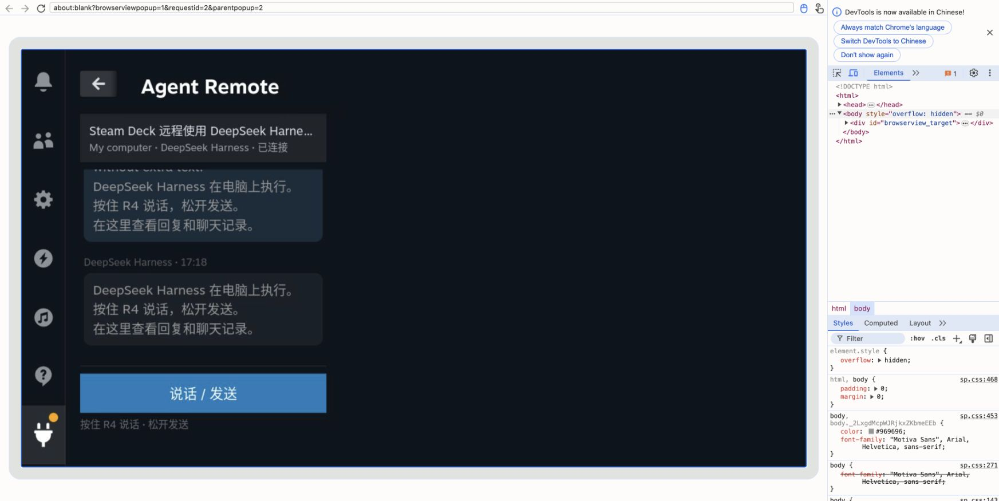

# Agent Remote

在 Steam Deck 游戏模式里，直接查看电脑上的 **[DeepSeek Harness（DSH）](https://www.deepseek.com/harness/)** 的回复，按住背键说话，松开发送。代码执行和语音识别都在自己的电脑上。

**点开就看到最新消息；说话、发送、读回复在同一页。** 记住机器和会话，多台电脑可以切换。支持 R4/L4/R5/L5、面板 X 键和触屏按钮，支持发送前编辑识别文字、查看历史、后台回复通知。

[英文实机界面](docs/media/steamdeck-conversation-en.png) · [中英文语言设置](docs/media/steamdeck-settings-en.png)

新版截图来自真实 Deck 的 Steam／Decky 渲染器，通过远程调试投射捕获；可见调试框架，聊天为专门创建的公开演示内容。

## 安装

先按[完整安装文档](docs/SETUP.md)在执行机器配置 bridge、DSH Web 和本地 whisper.cpp 语音模型，再从 [Releases](https://github.com/kongdayan/decky-agent-remote/releases) 下载 ZIP，用 Decky 的开发者 ZIP 安装入口安装。

插件内添加机器的 URL 和 bridge 随机生成的连接令牌，连接成功后选 DSH 会话即可。默认按住 R4 说话，松开识别并发送；短按打开消息。机器和会话只需选一次。不要把令牌发到聊天、Issue 或截图中。

局域网、HTTPS、SSH 隧道、其他 VPN 都能用，**Tailscale 只是可选方案**。默认 bridge 仅监听回环地址，远程使用需明确配置可达地址。HTTP 局域网不加密，建议使用私有或加密网络。

这是 0.5.0 公开预览版本，并未宣称已经上架 Decky 商店。DSH 为必需支持；Codex 为可选适配，部分由其他 app-server 持有的桌面会话只能读。审批仍在执行机器处理。界面支持简体中文和英文；语音支持普通话、英语和自动识别。升级保留中文／普通话默认设置。点击聊天页顶部进入设置，即可分别选择「界面语言」和「语音语言」，立即生效。聊天原文不会被翻译。中英文语音需要多语言 Whisper 模型，不能使用仅支持英语的 `.en` 模型。

[验证范围](docs/VALIDATION.md) · [交互审计](docs/UX-AUDIT.md) · [隐私和安全](SECURITY.md) · [贡献指南](CONTRIBUTING.md)。宣传图中对话使用虚构演示内容，设备带壳效果图为合成示意。
